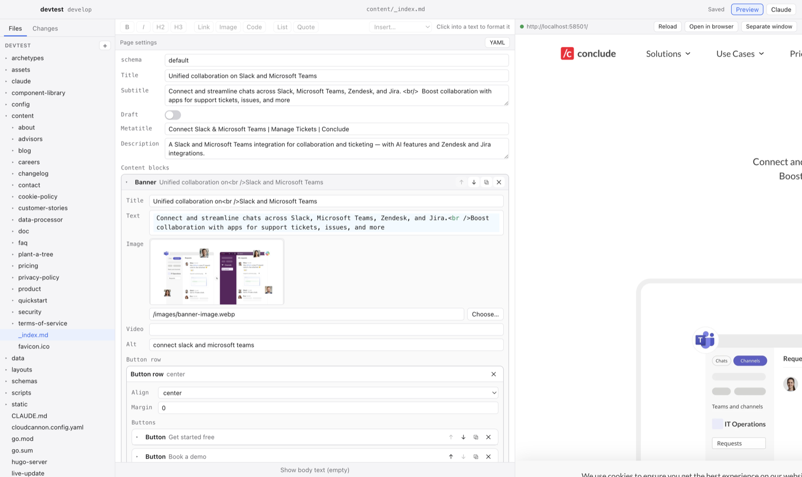

# Galley

Galley is a Mac app for editing the [conclude.io](https://conclude.io) website. It works on a
normal checkout of the site and puts everything in one window: the pages, a form for each
page's settings and content blocks, a markdown editor for prose, a live preview, Claude, and
the git steps needed to get a change reviewed.



The [Galley manual](docs/manual/README.md) explains how to use it, step by step; Galley
shows the same manual under **Help ▸ Galley Manual**.

## Installation

You need a Mac running macOS 12 or later and access to the `teamconclude` organisation on GitHub.

1. Open **Terminal**: press ⌘ Space, type `Terminal`, press Return.
2. Paste this line and press Return:

   ```sh
   curl -fsSL https://github.com/teamconclude/galley/releases/latest/download/install.sh | sh
   ```

   It downloads the latest Galley into Applications and opens it. Run the same line again
   any time to update by hand; Galley also updates itself.

3. On first start Galley shows what it is setting up. It downloads what the Mac lacks and
   asks for the two things only you can do:
   - **git** and **Hugo**, the site generator, are used from the Mac when installed, from
     Homebrew for example, and otherwise downloaded into Galley's own folder. Galley's own
     Hugo is refreshed weekly.
   - **Claude Code** is installed with its official installer. The first time the Claude
     pane opens it asks you to sign in.
   - **GitHub sign-in** shows a short code and opens github.com; enter the code there. That
     is what lets Galley fetch and push the site. Skip it if you use SSH keys with GitHub.
   - **The site checkout** is cloned into `~/Conclude/web` with one click, or you point
     Galley at an existing checkout.

   The Setup entry in the Galley menu shows this list again at any time.

If you prefer to install by hand, download the `.dmg` from the
[latest release](https://github.com/teamconclude/galley/releases/latest) and drag Galley to
Applications. Because the app is not yet signed with an Apple developer certificate, macOS
blocks the first start: close the warning, open System Settings › Privacy & Security, scroll
down and click **Open Anyway**. The Terminal line above avoids this, since macOS only checks
files that a browser downloaded.

## Using Galley

In brief; the [manual](docs/manual/README.md) has the details.

**Getting the site.** On first start, choose the folder where the site is checked out, or
pick **Clone** to get a fresh copy from GitHub. Galley remembers the checkout.

**Pages.** The left side lists the files of the site. The `content` folder holds the
pages, one markdown file each, grouped by section and newest first. Each file shows a
second line: a page's title, with drafts and scheduled pages marked, or the size of other
files and when they last changed; the rows button switches to one line per file. **Find
Page** (⌘P) finds a page by words of its title, its address, an old address or its file
name. The `+` button and the right-click menu create, rename, duplicate and delete files;
the File menu does the same for the open page, and makes a page from a Word or Markdown
document or adds images to the section. A new page copies the settings of the newest page
in the same folder, so it fits its section. Dropping images onto the tree or into a text
puts them under `static/images`.

**Editing.** A page opens as a form of its settings. Marketing pages are built from content
blocks, shown as cards that can be opened, reordered, duplicated and removed, with a menu to
add new ones. Text fields with formatting get a markdown editor and the toolbar at the top.
Images are chosen from the site's images, uploaded or dropped in; the picker shows the
images new on the branch first and one folder at a time, starting at the page's section.
**YAML** at the top right shows the
raw settings for the rare case the form does not cover something. Below the settings, **Show
body text** opens the page's prose. Everything is saved as you type.

Text pasted from Google Docs, Word or a web page becomes Markdown with its headings, lists,
emphasis and links; text that already is Markdown pastes as it is, and **Paste as plain
text** (⌘⇧V) pastes the clipboard's text exactly. A pasted picture is saved into the
section's images folder, and a whole page pasted into an empty page fills in its settings
too. Links to addresses on the site that lead to no page or file get a red wavy underline.

**New pages.** The `+` button asks for the title, the address and the publish date. **From
a document…** makes the page from a Word, Markdown or web document: its headline becomes
the title, the text and links come over exactly, its pictures go to the section's images
folder, and notes above the headline, such as a proposed address, stay out of the page.

**Preview.** The right side shows the page as it will look, updated after every change.
**Separate window** moves it out of the main window, for example to a second screen.

**Claude.** The Claude button opens Claude Code in the checkout. Ask it to draft a blog
post, rewrite a section, or find where something is on the site. Galley starts it for an
editor: it knows which page is open, edits pages without asking for each one, leaves
commits and publishing to the Changes tab, and runs on the model chosen in Settings
(Opus unless changed). Files dropped on the pane are copied where Claude can read them,
and Word or web documents arrive converted to Markdown by rule, so their text and links
come through exactly. Galley's own skills, `galley:import-document` and
`galley:add-images`, live in `resources/claude-plugin/`; anything about one particular
site belongs in that site's CLAUDE.md and `.claude/skills/`.

**Publishing.** The **Changes** tab lists what you changed and shows a diff for each file,
or the picture for an image. Work happens on a branch: the branch menu creates one, named
after you. Write a short message and **Commit** the selected files; **Push** uploads them
to your branch on GitHub, where nothing goes live yet. **Merge into develop** adds your
commits to the shared branch and you carry on with your own. The Publishing section moves
the shared branches on along `develop`, `staging` and `production`, whichever exist on
GitHub, named after the site each one builds when its Hugo environment (`config/<branch>/`) sets a `baseURL`.
Every count opens into its commits with author, date and files, and the merge and publish
confirmations name whose work goes along. Galley checks GitHub every few minutes and
offers **Pull** when a colleague added to your branch and **Update** when the base moved
on. The shared branches only follow GitHub: commits made on one by mistake get **Move to
a new branch**. New files the site does not use, such as documents kept in the checkout, are
listed apart under "Not part of the site": show them in the Finder to move them away, move
them to the Trash, or add them after a warning. New files in odd places, a document among
the pages or a file name with spaces, are marked and left out of the commit until ticked,
and images dropped among the pages go to the section's images folder.

**Review links.** The share button at the top right copies a link to the current branch
and the open page, sending the branch to GitHub first if it is not there yet, e.g.
`https://conclude.io/galley/open/?branch=buket/pylon&page=content/compare/pylon.md`. The
page there hands it to `galley://open`, which opens the colleague's Galley; pull requests
Galley opens carry the link too. Galley first shows the branch's commits and authors, then
commits the reader's own changes to their branch, switches, and opens the page. A bar
offers the way back. **File ▸ Open Review Link…** takes a pasted link.

## Development

Galley is an Electron app written in TypeScript with React, built with electron-vite. The
main process talks to git and Hugo and serves the checkout to the renderer, where CodeMirror
provides the editors and xterm.js the Claude pane.

```sh
npm install
npm run dev          # start with live reload
npm run typecheck
npm run lint
npm run build:unpack # packaged app in dist/mac-arm64, for trying the packaged behaviour
npm run build:mac    # .dmg and .zip in dist/
```

Galley reads the site's Hugo config, `hugo.*` or `config.*` in YAML, TOML or JSON, for the
site name, the content and static folders, the components mount, the markdown output
format behind the Markdown preview and the plain-text home outputs it previews from their
data files. Pickers come from every `data/*.yaml` that lists maps with a `name`, the
Insert menu from `layouts/shortcodes/`. There is no Galley configuration file.

The page forms are generated from the component schemas in the site checkout,
`components/<name>/<name>.yml` (label, description and a `fields` map of
type, label, placeholder, help and default per key), or from `<name>.bookshop.yml` while a
site still uses Bookshop, with labels derived from the keys. Nothing in Galley needs to
change when a component is added.

### Releasing

A release is a tag. Tag the commit and push the tag:

```sh
git tag v0.2.0
git push origin v0.2.0
```

GitHub Actions builds the app with that version and publishes a release `v0.2.0` with the
DMG, the zip and `latest-mac.yml`, which installed copies read to find updates. The version
in package.json stays `0.0.0`; the workflow sets it from the tag.

Without an Apple developer certificate the build is signed ad hoc, which is why the first
install needs Open Anyway. Adding the `CSC_LINK`, `CSC_KEY_PASSWORD`, `APPLE_ID`,
`APPLE_APP_SPECIFIC_PASSWORD` and `APPLE_TEAM_ID` secrets to the repository turns on signing
and notarisation without further changes.

`GALLEY_UPDATE_FEED=<url>` points the updater at another folder holding `latest-mac.yml` and
the zip, to test updates against a local build.

### Testing on a fresh Mac

`GALLEY_FRESH=git,hugo,claude` makes a development build behave as if those tools were
missing, so the downloads run on a machine that has them. The real test is a fresh macOS
virtual machine with [tart](https://tart.run): create one with
`tart clone ghcr.io/cirruslabs/macos-sequoia-base:latest galley-test`, build the DMG, and
run `scripts/vm-test`. It installs the DMG in the VM, starts Galley, and copies a screenshot
and Galley's log (`~/Library/Logs/Galley/galley.log`) back into `dist/vm/`. `tart run
galley-test` opens the VM's screen to click through the setup by hand.

GitHub sign-in needs the client id of a GitHub OAuth app with the device flow enabled, set
as `builtInClientId` in `src/main/github.ts`; `GALLEY_GITHUB_CLIENT_ID` overrides it for
development. Without it the sign-in step is skipped and git relies on the Mac's own
credentials.

## License

BSD 3-Clause, see [LICENSE](LICENSE).
