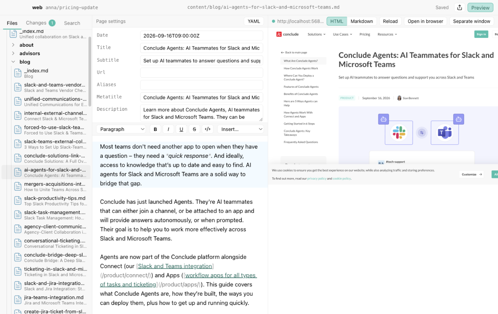
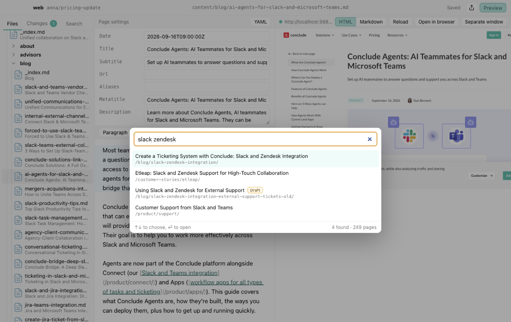
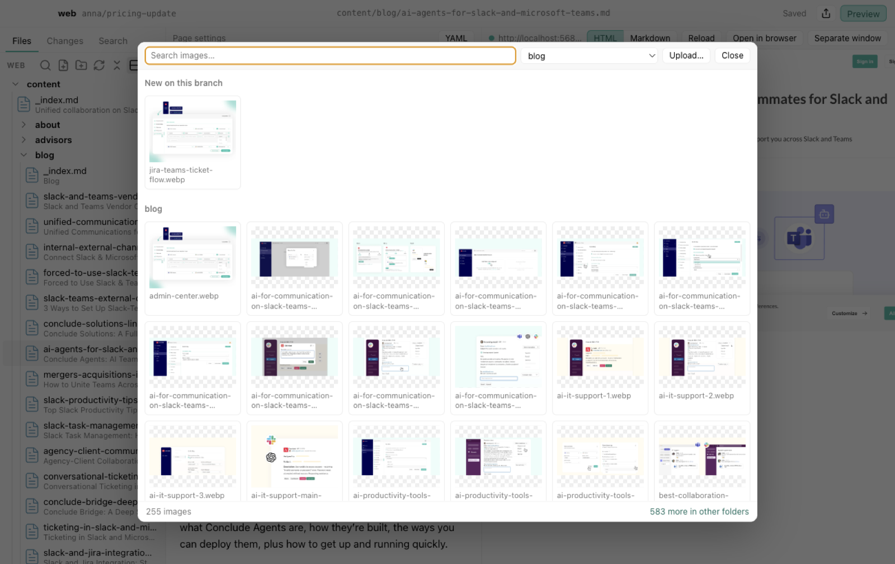
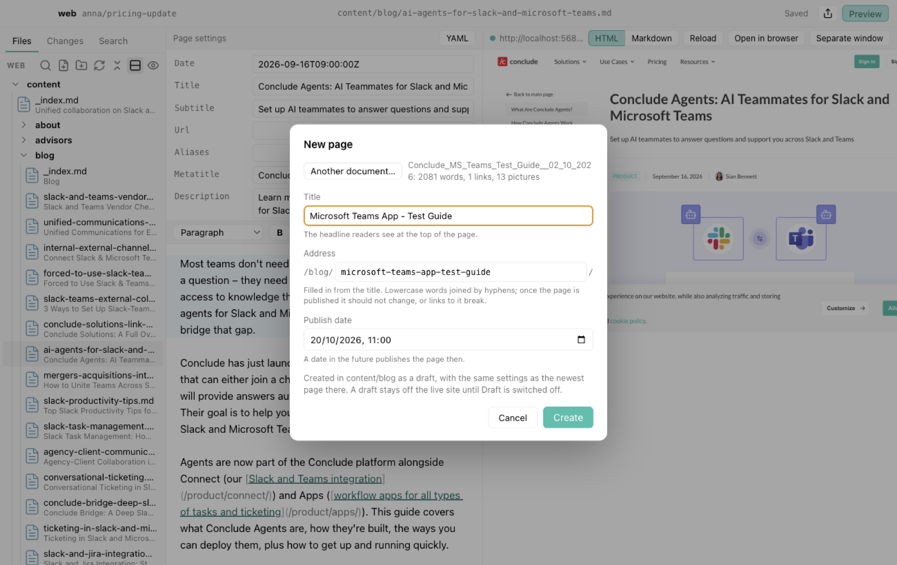
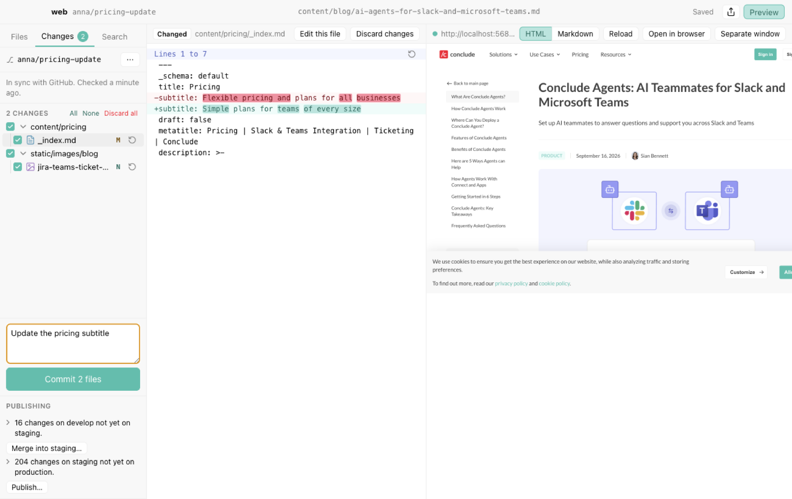
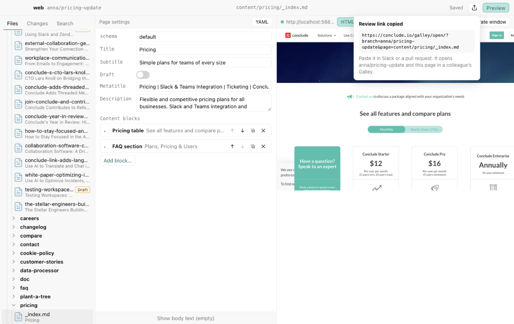

# Galley manual

Galley is the editor for the [conclude.io](https://conclude.io) website. You find and edit
pages, add pictures and new pages, see the result as you type, and send your work on its
way to the live site, all in one window. This manual walks through each of those.
**Help ▸ Galley Manual** (⌘?) shows it inside Galley, and Claude can answer questions about
Galley from it.



- [How your work reaches the site](#how-your-work-reaches-the-site)
- [Getting started](#getting-started)
- [The window](#the-window)
- [Finding a page](#finding-a-page)
- [Editing a page](#editing-a-page)
- [Pictures](#pictures)
- [New pages](#new-pages)
- [The preview](#the-preview)
- [Saving your work](#saving-your-work)
- [Publishing](#publishing)
- [Sharing work for review](#sharing-work-for-review)
- [Claude](#claude)
- [Settings](#settings)
- [Keyboard shortcuts](#keyboard-shortcuts)
- [When something goes wrong](#when-something-goes-wrong)

## How your work reaches the site

The website lives on GitHub. Galley keeps a copy of it on your Mac, and you edit that copy.
Nothing you do in Galley changes the live site until it is published, so feel free to try
things out.

Your work moves through a few stages:

1. **Your branch.** You work on a branch of your own, a private line of work named after
   you, such as `anna/pricing-update`. Galley saves every edit on your Mac as you type.
2. **Commit.** When a piece of work is ready, you commit it: Galley records the changed
   files with a short note on what you did, and sends them to your branch on GitHub.
3. **Merge into develop.** `develop` is the branch the whole team shares, and the test
   site, conclude.dev, shows it. Merging adds your work to it.
4. **Publish.** From `develop`, the team's work moves on to `production`, the live site,
   conclude.io.

The **Changes** tab at the left shows where you stand and offers the next step each time.

## Getting started

### Installing

You need a Mac and access to the `teamconclude` organisation on GitHub.

1. Open **Terminal**: press ⌘ Space, type `Terminal`, press Return.
2. Paste this line and press Return:

   ```sh
   curl -fsSL https://github.com/teamconclude/galley/releases/latest/download/install.sh | sh
   ```

Galley lands in your Applications folder and opens. It updates itself from then on; when
an update is ready, a button at the top right offers to restart into it.

### The first start

On the first start Galley shows a list of what it sets up and works through it. Most of it
needs nothing from you. Two steps do:

- **Sign in to GitHub.** Galley shows a short code and opens github.com. Enter the code
  there and confirm. This lets Galley fetch the site and send your work.
- **The site.** Click to download the site into `~/Conclude/web`, or choose a copy you
  already have.

The Claude step installs Claude Code. The first time you open the Claude pane, it asks you
to sign in with your Claude account. **Galley ▸ Setup…** shows the list again at any time.

### Other sites

Galley edits other Hugo sites too. **File ▸ Open Site…** (⌘O) opens a site that is already
on your Mac, or copies one from GitHub: choose **From GitHub** and give the repository's
address. **File ▸ New Site…** starts a new site from the Galley template, with a home page
built from blocks, an about page and a blog. A new site stays on your Mac until a GitHub
repository is added for it; until then the Changes tab says so, and merging happens on your
Mac only. **File ▸ Open Recent** lists the sites you opened lately.

## The window

- **Left: tool windows.** **Files** lists the site's pages and files, **Changes** shows your
  work and the next step for it, and **Search** searches the whole site. At first Files
  and Search share the top as two tabs and Changes sits below, so you see your pages and
  your changes at once.
- **Middle: the open page.** Its settings at the top, its text below. Galley starts on
  the home page.
- **Right: the preview**, the page as it will look on the site, a tool window too.
- **Bottom: Claude**, a tool window too, when you open it.
- **Top right:** the share button, which copies a link to your work for a colleague, and
  buttons to show or hide the preview and Claude.

Drag the borders between the parts to make one larger. **View ▸ Larger text** (⌘+) makes
everything larger.

**Arranging the tool windows.** Files, Changes, Search, the preview and Claude can go along
the left, the right and the bottom of the window, up to two in each place: stacked at the sides,
side by side at the bottom. Drag a tool window by its tab; as you drag, a frame shows where
it will go.

- Over a row of tabs, it goes among them at the line that shows, for example to put
  Search before Files.
- Over the near half of a place with one tool window, it joins it as a tab: the top half
  at the sides, the left half at the bottom. Over the far half, it gets a place of its own
  next to it.
- At the left or right edge of the window, where no tool windows are yet, it starts a new
  place there; the same at the bottom of the editor.
- Dragged out of Galley's window, it gets a window of its own, which follows the pointer
  from there; let go anywhere, for example on a second screen, and it stays there. Dragged
  back over Galley's window before letting go, it docks where the frame shows.
- Esc puts it back where it was.

Such a window moves by its tab bar, which is its title bar. Moved over Galley's window it
turns see-through and a frame shows where it would go; let go there, it docks. Let go
anywhere else, the window just moves. Closing the window also puts the tool window back. Galley remembers where
each such window was, on which screen and how large, and opens it there again, also the
next time Galley starts.

Drag the borders to size the places and to share one between two tool windows. **View ▸
Reset Tool Windows** brings back the first arrangement.

**Light or dark.** Galley follows macOS's light or dark appearance, in the colours of the
Conclude app; **Settings** can keep it light or dark instead. The preview always shows the
site in its light colours.

## Finding a page

### The list of files

The `content` folder holds the pages, one folder per part of the site: `blog`, `compare`,
`product` and so on. Each page shows its file name, with its title below it. Pages in a
folder are listed newest first. Pages that are not on the live site are marked:

- **Draft**: the page is switched off and stays off the site until Draft is switched off.
- **Scheduled**: its publish date is still to come; it appears on the site on that day.
- **Expired**: its expiry date has passed, so it has left the site.

Other files show their size and when they last changed. The `static` folder holds the
pictures and downloads, and `data` holds lists the site uses, such as the authors. The
eye button above the list shows every file of the site, and the rows button switches to
one line per file.

### Find Page

**File ▸ Find Page…** (⌘P), or the magnifying glass above the list, finds a page by what you
know of it: words from its title, its address on the site, an old address that forwards
to it, or its file name. You can also paste a link to the page, from the live site, the
preview or a review link. Use the arrow keys and Return, or click. With nothing typed, it
lists the newest pages.



### Search

The **Search** tab finds text anywhere on the site and lists every place it occurs; click
one to open the page there. **Content only** limits the search to pages. The arrow beside
the search field opens **Replace**, which changes every match at once; check the list of
matches first.

## Editing a page

A page opens as a form of its settings, with its text below.

- **Settings** are things like the title, the date, the description that search engines
  show, and the picture used when the page is shared. Each has its own field.
- **Content blocks.** Marketing pages are built from blocks, such as a hero, a feature
  list or a call to action. Each block is a card: click it to open it, and use the
  buttons on it to move it up or down, duplicate it or remove it. **Add block…** adds a
  new one.
- **The text.** Blog posts and similar pages have their text below the settings. **Show
  body text** opens it on pages that have both blocks and text.

Everything saves as you type. ⌘Z undoes, ⌘S saves at once.

### Writing text

The toolbar above the text sets headings, bold, italic, underline and strikethrough. The
text is written in Markdown, a simple way of marking up text: `**bold**`, `## Heading`,
`- list item`. You can type it directly or use the toolbar; the toolbar shows which style
the cursor is in.

- **Links:** select the words and choose **Insert ▸ Link…**. Links to pages on the site
  are written as their address, such as `/product/support/`. A link to an address where
  the site has no page gets a red wavy underline, so you catch typos before they go live.
- **Insert** also offers the site's special elements, such as buttons or embedded videos.
- **YAML** at the top right shows the page's settings as text, for the rare case the form
  does not cover something.

### Pasting text

Text copied from Google Docs, Word or a web page keeps its headings, lists, bold and
italic, and its links. Pictures in it are saved into the site. **Edit ▸ Paste as plain
text** (⌘⇧V) pastes only the words.

## Pictures

There are several ways to add a picture:

- **Choose…** next to a picture setting, or **Insert ▸ Image…** in the text, opens the
  picture library. It shows the pictures added on your branch first, then one folder at a
  time, starting with the folder for the page's part of the site. Type to search, or pick
  another folder from the menu.
- **Upload…** copies a picture from your Mac into the site in one step.
- **Drop** a picture from the Finder onto a picture setting, the Image dialog, the picture
  library, or into the text where it should go.
- **Paste** a screenshot or a copied picture into the text.
- **Drag** a picture from the file list onto the preview, to where it should appear. A line
  shows where it will go, and a note at the bottom says what the drop will do. Dropped on
  a picture already on the page, it takes that picture's place.
- **File ▸ Add Images…** copies several pictures at once.



Galley puts pictures where the site expects them, in the images folder of the page's part
of the site, such as `static/images/blog`, and names them in lowercase without spaces.
When you add a picture to the text, write a short description of what it shows. Readers
who cannot see the picture hear it, and search engines read it.

To swap a picture for a new one everywhere it appears, right-click it in the file list and
choose **Replace…**. Galley shows the old and new picture and the pages that use it, and
saves the new one under a new name, such as `screenshot-v2.png`. Every page then shows it.
The new name matters: browsers keep a published picture for weeks, so under the old name
many readers would go on seeing the old one. Keep the old name only if other sites or
emails link to the picture. **Rename…** also changes the pages that show the picture, and
**Move to Trash** first tells you which pages would lose it.

## New pages

**File ▸ New Page…** (⌘N), or the page button above the list, creates a page in the folder
of the page you have open. Give it:

- a **title**, the headline readers see;
- an **address**, which follows the title until you change it. Keep it short, lowercase
  and joined with hyphens, and do not change it once the page is live, or links to it
  break;
- a **publish date**. A date in the future schedules the page for that day.

The new page starts as a **draft** and takes its settings from the newest page in the same
folder, so it fits in. Switch Draft off when it is ready.



### From a document

**From a document…** in the same dialog, or **File ▸ New Page from Document…** (⌘⇧N),
makes the page from a Word document, a Markdown file or a saved web page. Its headline
becomes the title, the text comes over with its headings, lists, tables and links, and
its pictures go into the site. Notes above the headline, such as a proposed address, stay
out of the page; the dialog shows them, and picks up a proposed address.

### Copying, renaming and removing pages

**File ▸ Duplicate Page…** copies the open page under a new name, as a start for a similar
one. **Rename Page…** changes its file name. The file name is usually the page's address,
so do not rename a page that is live, or links to it break. **Move Page to Trash…** removes
it; until you commit, the arrow next to it in the Changes tab brings it back. Right-click a
file in the list for the same commands, and for **New folder…**.

## The preview

The preview shows the page as the site will show it, and follows along as you type and
move through the text. **Markdown** shows the plain-text version of the page that the site
offers to AI tools. **View ▸ Preview in its own window** (⌥⌘P) moves it into a window of
its own and back, for example for a second screen; dragging its tab out of Galley's window
does the same. **Open in Browser** opens it in your web browser.

**Following links.** Click a link in the preview and the page it leads to opens in the
editor too. Some pages of the site have no file of their own, such as the list of posts
in a category; those show in the preview, and the editor keeps the page you had. Links to
other websites open in your web browser.

**Scrolling.** Scroll the preview and the text in the editor scrolls along to the same
heading or paragraph. Your cursor stays where it was. On a page built from content blocks,
such as the home page, the block at the top of the preview is outlined in the list of
blocks.

**Back and forward.** The arrows at the left of the preview's bar, **View ▸ Back** (⌘[) and
**View ▸ Forward** (⌘]), and the back and forward buttons of a mouse go through the pages
you looked at, as in a web browser: pages opened from the list, Find Page, Search or a link
in the preview. Going back puts the cursor and the scroll position back where you left
them.

Hugo, the program behind the preview, starts again by itself if it stops. If it keeps
stopping, the preview shows Hugo's message, which usually names the page at fault; fix
that page and click **Restart Hugo**.

## Saving your work

Open the **Changes** tab. At the top is your branch and what to do next; below, the files
you changed.



### Your own branch

Always work on your own branch. If you are on `develop`, Galley says so: click
**New branch** and give it a short name. Your changes come along. If you committed on
`develop` by mistake, **Move to a new branch…** moves those commits to a branch of yours.
The ⋯ menu next to the branch name creates branches and switches between them.

**Delete branch…** in the same menu removes a branch you no longer need, such as one you
tried something out on. Only your own branches, the ones starting with your name, can be
deleted. Galley says first how many commits would be lost, and deletes the branch on GitHub
too unless colleagues' work is on it. If you are on the branch, Galley moves you to
`develop` first.

### Committing

1. Click a file to see what changed: removed text in red, added text in green, pictures
   side by side. For a page, or a picture of a page, the preview shows that page.
2. Tick the files that belong together. Unticked files stay as they are, for a later
   commit.
3. Write a short note on what you did, such as "Update pricing for the Pro plan", and
   click **Commit**, or press ⌘Return. **Write with Claude** has Claude look at the ticked
   files and write the note for you; read it, change it if you like, then commit.

Galley sends the commit to your branch on GitHub straight away. To undo changes you do not
want, use the arrow next to a file, or **Discard all**. New files go to the Trash, so you
can still get them back.

### Files Galley warns about

A warning sign marks a new file that looks out of place, such as a document among the
pages, a picture outside the images folders, or a name with spaces or capitals. Such files
start unticked, and Galley asks before committing them. Move them or rename them in the
Files tab.

**Not part of the site** lists files in your copy of the site that the site does not use,
such as notes or source documents. They never go to GitHub. Show them in the Finder to
move them somewhere else, move them to the Trash, or add them to the site if they belong
there.

### Keeping up with the team

Galley checks GitHub every few minutes. Your branches that have nothing GitHub lacks
follow it by themselves, also when a colleague rewrote one, and `develop` moves along
as soon as you merge into it. Edits you have not committed stay as they are.

- **Pull** appears when someone else added to your branch while you have commits GitHub
  does not have yet, or edits that clash with theirs. Your own commits go on top of
  theirs.
- **Update** appears when `develop` has moved on since you started your branch. It brings
  your branch up to date with the team's work. If a colleague added to your branch, pull
  first.

Both send the result to GitHub straight away, so a review link always shows your latest
work.

Every count, such as "3 changes on develop not in this branch", opens into the list of
commits behind it: who made them, when, and which files they touched. Click a commit to
see its files, and a file to see what the commit changed in it, in the editor's place, with
the page in the preview.

**History** at the bottom of the Changes tab lists the latest commits on your branch,
those from develop included; on develop, it is develop's history. They open the same way.

### When changes conflict

Sometimes you and a colleague changed the same lines. Pull or Update then stops halfway,
and the Changes tab says which files are affected; they are marked **!**. The first of
them opens in the editor as plain text, settings and all, with both versions of each
conflicting passage: the one from develop (or GitHub) in blue, yours in green, between
marker lines. The preview pauses until the conflicts are settled.

You have three ways out:

- Settle each conflict in the editor: **Keep develop's version**, **Keep your version**,
  or **Keep both**, then edit the text until it reads right. Click the other files marked
  **!** in the Changes tab to open them. Then click **Continue**.
- **Ask Claude to resolve** hands the files to Claude, which combines both versions and
  tells you what it did. Check the result, then click **Continue**.
- **Cancel** puts your branch and your edits back as they were before.

If more of your commits touch the same lines, Galley stops again at the next one.

Edits you have not committed yet are set aside while your branch is brought up to date,
and put back at the end. If they clash with what came in, Galley stops in the same way,
with your edit in green. Once you continue they are back as uncommitted
edits; cancelling returns your branch and your edits to how they were before. Your branch
goes to GitHub only after everything is settled.

## Publishing

When your work is ready, **Merge into develop…** in the Changes tab adds it to `develop`,
and the test site, conclude.dev, shows it a few minutes later. The dialog lists what goes
along. Afterwards you carry on with your own branch.

The **Publishing** section at the bottom of the Changes tab puts `develop` live. Once the
team has checked the result on conclude.dev, **Publish…** updates the live site,
conclude.io, within a few minutes. It first shows whose work goes along, so check with
your colleagues before publishing their work.

## Sharing work for review

The share button at the top right copies a review link to your branch and the page you
have open. Paste it in Slack, or wherever a colleague will see it. If your branch, or your
latest commits, are not on GitHub yet, Galley sends them there first, so your colleague
sees what you see. Changes you have not committed are not included; commit them first.



When a colleague clicks the link, Galley opens with a review dialog. It lists the
commits on the branch and who made them, and only then switches. Click a commit to see its
files, and a file to see what changed in it. Your own unfinished
changes are committed to your branch first, so nothing gets mixed up. A blue bar at the top
shows the branch you are reviewing; **Back to** your branch takes you back. You can edit
during a review: what you commit goes to the branch you are reviewing.

If clicking the link does nothing, copy it and use **File ▸ Open Review Link…**.

## Claude

The **Claude** button (⌘J) opens Claude, an AI assistant, at the bottom of the window. Type
what you want in plain words and press Return; ⇧Return starts a new line.

- "Draft a blog post about connecting Jira and Microsoft Teams, in the style of our other
  posts."
- "Shorten the introduction of this page."
- "Which pages mention our free trial?"
- "How do I send my work to a colleague for review?" Claude knows this manual and answers
  questions about Galley from it.

Claude answers in the pane, and each thing it does, such as reading or changing a page,
shows as a line of its own; click a change to see it. Every change also appears in the
Changes tab, where you commit or discard it as usual. You can also ask Claude to commit,
such as "Commit my changes": Galley then commits the ticked files with a note Claude
writes, and sends them to your branch on GitHub, just as the Commit button does. Claude
does not commit on `develop` or another shared branch, and never publishes.

**The open page.** The row below the text field shows the page you have open, and Claude
is told about it with each message, so "this page" works. Its × leaves it out; it is back
when you open another page, or click it.

**Files.** Drop files onto the pane, or click **+**, to hand them to Claude, such as a Word
draft or a screenshot. Word documents and web pages arrive as text with their links intact.

**When Claude asks.** Sometimes Claude needs your go-ahead, for example to run a command,
or asks a question with a few answers to choose from. It shows a card in the conversation:
click **Allow** or **Don't allow**, or an answer. If you are working in another app
meanwhile, Galley stays where it is: its icon in the Dock bounces once and shows how many
questions wait. The button at the right of the row below
the text field sets how often Claude asks:

- **Auto**, the usual setting: Claude goes ahead with what is safe and asks when unsure.
- **Ask before commands**: Claude changes files freely and asks before running anything.
- **Ask before changes**: Claude shows each change to a file and asks before making it,
  and asks before every command.

**Stopping and starting over.** The square button, or Esc, stops Claude. **New
conversation** at the top of the pane starts afresh. The model button in the row, such as
**Opus 5.5**, switches between Opus, the most careful, and Sonnet, which is quicker.

**Your Claude account.** Claude runs under your own Claude account, shown at the top of the
pane. The first time, the pane offers **Sign in…**: sign in on the page that opens in your
browser.

## Settings

**Galley ▸ Settings…** (⌘,):

- **Appearance**: as set in macOS, or always light, or always dark.
- **Remove a merged branch from GitHub** (on): after you merge into develop, your branch
  disappears from GitHub to keep the list tidy. You keep working on it here, and your next
  commit brings it back.
- **Claude Code pane**: turns Claude off entirely; setup then does not install it.
- **Claude pane shows**: a chat with Claude, or Claude Code's own terminal, the way
  developers use it.
- **Claude model**: Opus, the most careful, or Sonnet, which is quicker.

## Keyboard shortcuts

| Shortcut | Does                           |
| -------- | ------------------------------ |
| ⌘O       | Open a site                    |
| ⌘P       | Find a page                    |
| ⌘N       | New page                       |
| ⌘⇧N      | New page from a document       |
| ⌘S       | Save now                       |
| ⌘Z, ⌘⇧Z  | Undo, redo                     |
| ⌘F       | Find on the page               |
| ⌘R       | Find and replace on the page   |
| ⌘⇧F      | Search the site                |
| ⌘⇧R      | Search and replace in the site |
| ⌘⇧V      | Paste as plain text            |
| ⌘⇧P      | Show or hide the preview       |
| ⌥⌘P      | Preview in its own window      |
| ⌥⌘R      | Reload the preview             |
| ⌘[, ⌘]   | Back, forward                  |
| ⌘Return  | Commit, in the commit note     |
| ⌘J       | Show or hide Claude            |
| Esc      | Stop Claude                    |
| ⌘+, ⌘-   | Larger or smaller text         |
| ⌘0       | Text at its usual size         |
| ⌘,       | Settings                       |
| ⌘?       | This manual                    |

## When something goes wrong

**The preview is empty or says the server stopped.** Galley restarts Hugo by itself, so
when the preview stays stopped, a page probably has an error in its settings; the message
usually names the file. Fix it and click **Restart Hugo**.

**"Could not reach GitHub."** Check your internet connection. Galley tries again by itself
every few minutes; the ⋯ menu in the Changes tab has **Check for updates now**.

**Galley says it is not signed in to GitHub.** Open **Galley ▸ Setup…** and sign in again.

**My change is not on conclude.dev.** Check the Changes tab: the change must be committed
and merged into develop. The site takes a few minutes to rebuild.

**Claude asks for permission all the time.** Check the button at the right of the row
below Claude's text field; **Auto** asks least.

**Claude asks me to sign in.** Click **Sign in…** and sign in with your Claude account in
the browser.

**A link has a red wavy underline.** No page or file lives at that address. Check for a
typo, or use Find Page to look up the right address.

**I want to start over with a page.** Use the arrow next to the file in the Changes tab
to discard your changes to it. Committed work can always be recovered; ask a developer.
